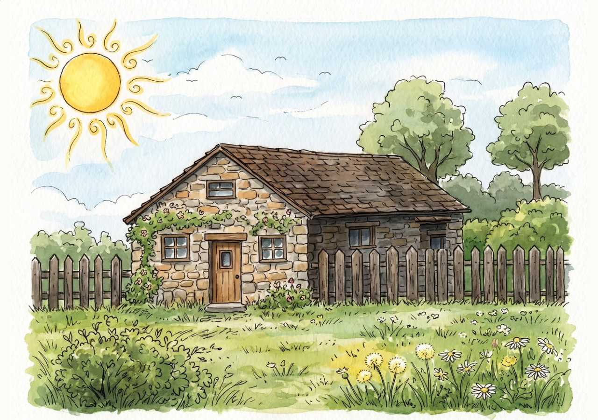
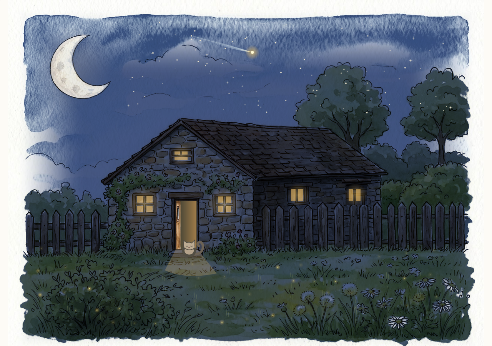

# Watercolor Cottage Comes Alive

A watercolor drawing by Igor Semechkin, brought to life with HTML, CSS and JavaScript. Tap the scene to change the weather, turn day into night, light the windows and meet the cat behind the door.

## Explore the drawing

There are no visible menus or control panels. The objects in the drawing are the controls.

| Tap or click | What happens |
| --- | --- |
| Sun or moon | Switch between day and night |
| Clouds | Cycle through calm, wind, rain and rain with gusts |
| Any of the five windows | Toggle that window's light independently |
| Door | Open or close the door and reveal the cat |
| Trees | Create a gust of wind and falling leaves |
| Flowers and dandelions | Release floating seeds and butterflies |
| Clear sky in the upper-right corner | Turn sound on or off |

Birds visit during the day. Stars, fireflies and an occasional comet appear at night. Sound starts after a user interaction and is synthesized in the browser.

## Run locally

Download the project and open `index.html` in a browser. No installation or build step is required. Images are embedded, so the scene can run offline.

- `index.html`: artwork and accessible interaction targets.
- `style.css`: layout and responsive sizing.
- `script.js`: Canvas animation, interactions and synthesized audio.
- `previews/`: screenshots of the scene.

The drawing keeps its proportions when the viewport changes. In short landscape viewports, it fits the available height rather than cropping the cottage.

## Implementation notes

- The scene preserves the original watercolor artwork rather than rebuilding the cottage from generic shapes.
- Animation is drawn with the Canvas 2D API.
- Interaction targets have English accessible labels and keyboard focus styles.
- The JavaScript waits for the document to be ready before starting. This also supports editors that execute their JS tab before the HTML body has been parsed.
- Reduced-motion preferences reduce the moving foliage. Other ambient effects remain animated.

## Compatibility

Tested in desktop Chromium and WebKit with phone, landscape and desktop viewport sizes. Browser audio requires a user gesture and can be affected by device sound settings. The latest startup correction was tested with JavaScript both before and after the HTML body; it has not yet been confirmed in the SoloLearn iPhone app.

## Credits

Original watercolor drawing: Igor Semechkin.

Interactive adaptation built with HTML, CSS, JavaScript, Canvas 2D and Web Audio.
